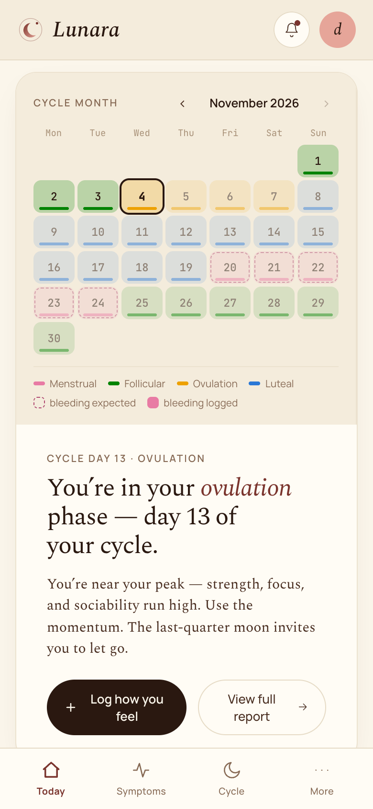
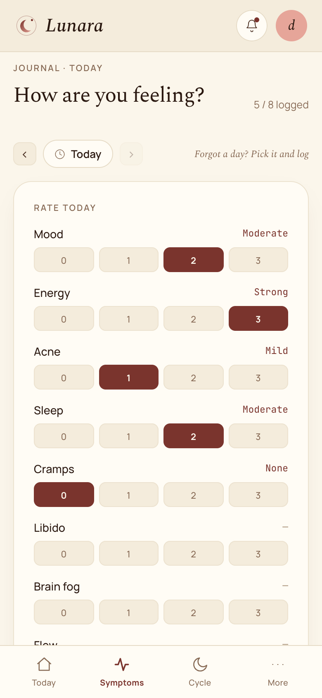

# Lunara

A private women's health tracker that changes with the user's life stage: first periods, regular cycles, trying to conceive, pregnancy, postpartum, perimenopause and menopause. Everything is kept on the user's own phone.

**Live:** https://lunara-inky.vercel.app (Turkish / English). The app installs to the phone's home screen from the browser.

<!-- Screenshot: home screen for the "regular cycle" stage (phone width) → docs/screenshots/home.png -->

---

## The problem

Women's health tracking is usually split across apps that each cover a single stage:
- a period tracker,
- a fertility app,
- a pregnancy app,
- a menopause app.

Each one has its own account, data model and assumptions. Moving from one stage to the next means starting from zero. Many of these apps also fill their screens with sample numbers or confident predictions even when the user has entered nothing.

Lunara puts these stages in one app, keeps the data on the device, and only shows what the user has actually recorded.

## What it does

- **Stage-aware app.** At setup the user picks one of seven life stages:
  - first periods,
  - regular cycle,
  - trying to conceive,
  - pregnancy,
  - postpartum,
  - perimenopause,
  - menopause.

  The navigation, symptom list, content and doctor summary change to match the stage.
- **Cycle and symptoms.** A calendar shows cycle phases and logged bleeding. Users rate daily symptoms on a 0–3 scale, see them in a monthly heatmap, and can make entries for past days.
- **Tools for each stage:**
  - trying to conceive: basal body temperature and LH test logs,
  - pregnancy: week and trimester from the due date, and kick counts,
  - postpartum: feeding and mood logs, plus the EPDS postnatal depression screening questionnaire,
  - first periods: a guide written for teenagers.
- **Medications.** Medication plans can repeat in cycles, and doses are logged as taken. A reference card shows the typical hormone levels for the current cycle day.
- **Doctor summary.** A printable summary of recent cycles, symptoms and medications, tailored to the current stage. Lab results recorded before the Labs section was switched off (see below) are still included.
- **Daily support.** Water and daily check-in reminders through notifications, and a JSON backup the user can export and restore.
- **Report a problem or wish.** A short form in Profile. Sending opens the user's own email app with the message ready; the user sends it. Only the text and a technical line (version, stage, language, browser) are included, never health entries.

### Temporarily switched off

Four sections are built but currently hidden:

| Section | What it contains |
|---|---|
| Movement | Exercise suggestions by cycle phase, with a daily checklist |
| Nutrition | Eating suggestions by cycle phase and stage, including seed cycling |
| Labs | Lab values entered by hand or imported from an e-Nabız PDF (Turkey's national health records portal), read in the browser and never uploaded; charts over time |
| Care team | A preview screen for a future AI companion chat (no backend, see Roadmap) |

They are switched off with one list in `src/features.js`. That list removes them from:
- the menus,
- the home screen cards,
- the links between screens.

Their code, the per-stage menu definitions and any data already saved are kept. Removing a section from the list turns it back on.

### Design rules the code follows

- **No sample data is shown as if it were the user's.** With no entries, screens stay empty.
- **When data is missing, the app does not guess.** Without a period start date, it shows no phase and draws no expected bleeding.
- **The app does not calculate or recommend medication doses.**
- **Moon-phase content is presented as tradition, not as a health claim.**

## Tech stack

| Area | What is used |
|---|---|
| Language / UI | JavaScript (JSX), React 18 |
| Build | Vite 8 |
| Offline and install | `vite-plugin-pwa` (Workbox service worker, web app manifest) |
| PDF parsing | `pdfjs-dist` (runs in the browser; used by the Labs import, currently switched off) |
| Data storage | Browser `localStorage`. There is no database and no backend. |
| Tests / lint | Vitest (255 tests in 25 files), oxlint |
| Hosting | Vercel (static hosting). Every push to GitHub deploys automatically. |
| Security headers | Strict Content-Security-Policy (no outside network connections allowed), HSTS, X-Frame-Options and others, set in `vercel.json` |
| Fonts | Manrope, Spectral and JetBrains Mono, all served by the app itself |

## Architecture

Lunara is a single-page web app with no server.

```
  User's phone / browser
  ┌───────────────────────────────────────────────────────────┐
  │  React UI                                                  │
  │  Home · Symptoms · Cycle · Medications ·                   │
  │  Stage screens (TTC, pregnancy, …)                         │
  │  (Movement · Nutrition · Labs · Care team: switched off    │
  │   in features.js)                                          │
  │              │ reads / writes                              │
  │  App state (one React hook)  ──────►  localStorage         │
  │              │                        ("lunara.v1")        │
  │  Plain logic modules, covered by tests:                    │
  │  cycle maths · bleeding · stage content · reference        │
  │  ranges · lab PDF parsing (pdf.js) · backup validation     │
  │                                                            │
  │  Service worker: offline cache, notifications              │
  └───────────────────────────────────────────────────────────┘
                 ▲ static files only
        Vercel CDN  ◄──  GitHub (push = deploy)
```

- There are no accounts and no network calls at runtime.
- Imported backup files are checked field by field before they are loaded, so a damaged file cannot crash the app.

## Status

- **Live** since 14 July 2026 at https://lunara-inky.vercel.app.
- **Users:** a small, informal group. Usability feedback from a few people led to a simplification pass in August 2026 (see `SADELESTIRME-LOG.md`, in Turkish). The app collects no analytics, so there are no user counts.
- **Size:** about 12,600 lines of application code and 2,100 lines of tests, in 71 source files, about 70 commits.
- **Spin-offs:** three focused apps share this codebase's foundation:
  - Womentum and Perim (perimenopause and hormone therapy),
  - Unnie (first periods, for ages 11–15).
- **Hosting:** Vercel's free Hobby plan, which is for non-commercial use.

## How it was built

The code was written with AI:
- The interface started as a prototype made in **Claude Design** (Anthropic), which was turned into this Vite project.
- From then on, **Claude Code** (Claude, Anthropic) wrote the features, fixes and tests. All commits except one empty redeploy commit are marked as co-authored by Claude.

The author worked as product owner:
- defined what to build and why,
- tested on a phone,
- reported bugs,
- made the product and wording decisions. One example is the rule that the app must never show invented data as the user's own.

## Screenshots

<!-- Replace with real screenshots taken with demo data (see "Development" below). -->
| Home | Symptoms | Stage screen | Doctor summary |
|---|---|---|---|
|  |  |  |  |

## Roadmap (not built yet)

- **AI companion chat.** The "Care team" section holds a preview screen only, and it is currently switched off. It has no backend and sends nothing anywhere; a real version would need a server-side proxy to a language model.
- **Turning Movement, Nutrition and Labs back on.**
- **Sync between devices.** Today the data lives on one device; moving it means exporting and importing a backup.
- **App store release** (iOS / Android). Today it is a web app installed from the browser.

## Development

```bash
npm install
npm run dev      # local dev server
npm test         # vitest
npm run build
```

The app ships with no sample data. To take screenshots, open it in a fresh browser profile and load a demo backup file with **Profile → Import data file**.

---

*Lunara is a personal tracking tool, not a medical device. It does not diagnose and does not recommend treatment.*
